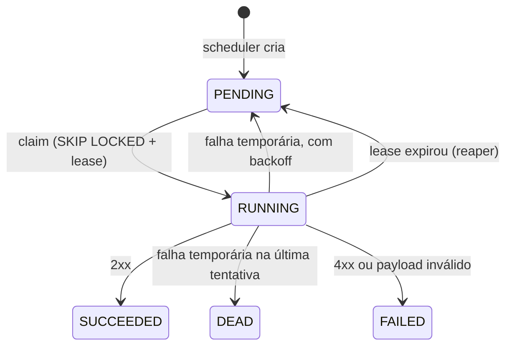

# Cronos

Agendador de jobs distribuído, escrito em Kotlin com Spring Boot e PostgreSQL.

Você cadastra jobs com um agendamento (cron, intervalo ou execução única) e o Cronos garante que cada ocorrência seja registrada **uma única vez**, mesmo com várias instâncias do scheduler rodando ao mesmo tempo e mesmo depois de o sistema ficar fora do ar.

> **Status:** em desenvolvimento. O scheduler, a política de misfire, a API de jobs e o worker (com lease, heartbeat, reaper, retentativas e timeout) estão prontos. Veja o [roadmap](#roadmap).

## Sumário

- [Por que este projeto](#por-que-este-projeto)
- [Arquitetura](#arquitetura)
- [Como o scheduler funciona](#como-o-scheduler-funciona)
- [Política de misfire](#política-de-misfire)
- [Como o worker funciona](#como-o-worker-funciona)
- [Stack](#stack)
- [Como rodar](#como-rodar)
- [API](#api)
- [Decisões de projeto](#decisões-de-projeto)
- [Estrutura do projeto](#estrutura-do-projeto)
- [Testes](#testes)
- [Roadmap](#roadmap)
- [Limitações conhecidas](#limitações-conhecidas)

## Por que este projeto

O `CronJob` do Kubernetes e o `@Scheduled` do Spring resolvem o caso simples, mas deixam de fora o que dói em produção:

| Necessidade | `@Scheduled` | `CronJob` (K8s) | Cronos |
|---|---|---|---|
| Rodar uma vez só com várias réplicas | não (cada instância dispara) | sim | sim |
| Histórico de execuções consultável | não | limitado | sim (tabela `executions`) |
| Política para disparos perdidos | não | limitada | sim (`SKIP`, `FIRE_ONCE`, `FIRE_ALL`) |
| Pausar e retomar por API | não | editando o recurso | sim |
| Evitar sobreposição de execuções | não | `concurrencyPolicy` | sim (`allowOverlap`) |
| Fuso horário por job | não | por cluster | sim |

O objetivo é praticar problemas clássicos de sistemas distribuídos: coordenação sem lock central, deduplicação, recuperação de falhas e semântica de entrega.

## Arquitetura


Os três componentes não se comunicam diretamente. Toda a coordenação acontece pelo PostgreSQL:

- **API** cria, consulta, pausa e retoma jobs.
- **Scheduler** transforma jobs vencidos em linhas na tabela `executions`.
- **Worker** reivindica execuções pendentes e as realiza chamando o webhook do job.

Como não há comunicação entre processos, dá para subir várias réplicas de cada um sem configuração extra.

### Modelo de dados

- `jobs`: definição do job (agendamento, payload, política de misfire, status) e o campo `next_fire_at`, que é o que o scheduler consulta.
- `executions`: uma linha por ocorrência de um job, com status, tentativas e dados de lease. A restrição `UNIQUE (job_id, scheduled_for)` impede duplicidade.

## Como o scheduler funciona

A cada tick (padrão: 1 segundo), numa única transação:

1. Seleciona um lote de jobs `ACTIVE` com `next_fire_at <= now()` usando `FOR UPDATE SKIP LOCKED`. Cada instância pega um conjunto diferente de jobs, sem esperar uma pela outra.
2. Para cada job, o `MisfireResolver` decide quais ocorrências devem virar execução e qual será o próximo `next_fire_at`.
3. Insere as execuções com `ON CONFLICT DO NOTHING`. Se outra instância já criou a mesma ocorrência, o insert é ignorado.
4. Atualiza `next_fire_at` (ou marca o job como `COMPLETED` se não houver mais ocorrências).
5. Se o lote veio cheio, repete imediatamente sem esperar o próximo tick.

Duas barreiras contra duplicidade, em camadas: o `SKIP LOCKED` evita que duas instâncias processem o mesmo job ao mesmo tempo, e a restrição `UNIQUE` garante a unicidade mesmo se a primeira falhar.

Um job com agendamento inválido é pausado e registrado em log, em vez de travar o lote inteiro.

## Política de misfire

*Misfire* é um disparo que ficou atrasado além da tolerância do job (`misfireThresholdSeconds`, padrão 60). Isso acontece, por exemplo, quando o sistema ficou fora do ar. O que fazer com o tempo perdido é configurável por job.

Exemplo: job que roda a cada minuto, sistema parado das 10:00 às 10:05:30.

| Política | Comportamento | Resultado no exemplo |
|---|---|---|
| `SKIP` | Ignora o que foi perdido e segue na próxima ocorrência futura | nenhuma execução; próximo disparo às 10:06 |
| `FIRE_ONCE` (padrão) | Cria uma única execução de recuperação | 1 execução (10:00); próximo às 10:06 |
| `FIRE_ALL` | Recupera todas as ocorrências perdidas, com limite de 100 por rodada | 6 execuções (10:00 a 10:05); próximo às 10:06 |

Se o limite de 100 for atingido no `FIRE_ALL`, o `next_fire_at` aponta para a próxima ocorrência ainda perdida e o tick seguinte continua de onde parou.

## Como o worker funciona

O worker roda na mesma aplicação (pode ser desligado com `cronos.worker.enabled=false` para ter instâncias só de scheduler).



1. **Claim.** A cada 500 ms, o worker reserva até o número de slots livres (`concurrency`, padrão 16) com um único `UPDATE ... WHERE id IN (SELECT ... FOR UPDATE SKIP LOCKED)`. A execução vira `RUNNING`, recebe `locked_by` (id do worker), `lease_expires_at` e `attempt + 1`. Só reserva o que consegue executar agora, para não segurar trabalho que outro worker poderia pegar.
2. **Webhook.** Cada execução roda numa virtual thread. O payload do job define a chamada:
   ```json
   { "url": "https://...", "method": "POST", "headers": { "Authorization": "..." }, "body": { ... } }
   ```
   `method` é `POST` por padrão. O worker envia os headers `Idempotency-Key` (id da execução), `X-Cronos-Execution-Id`, `X-Cronos-Job-Id`, `X-Cronos-Attempt` e `X-Cronos-Scheduled-For`. O `timeoutSeconds` do job é o prazo total da chamada.
3. **Resultado.** Gravado só se a execução ainda for deste worker (`WHERE locked_by = ? AND status = 'RUNNING'`). Se o lease expirou e o reaper já a devolveu para a fila, o resultado atrasado é descartado.

| Resposta | Tipo | Destino |
|---|---|---|
| 2xx | sucesso | `SUCCEEDED` |
| 5xx, 408, 429, timeout, erro de conexão | temporária | `PENDING` com backoff; `DEAD` ao atingir `maxAttempts` |
| demais 4xx, payload sem `url` ou inválido | definitiva | `FAILED`, sem retentativa |

**Backoff** exponencial com *equal jitter*: `base * 2^(tentativa-1)`, limitado a `backoff-max`, e sorteado entre metade e o valor cheio. Com o padrão de 1 s: ~0,5–1 s, ~1–2 s, ~2–4 s... até 5 min.

**Heartbeat e reaper.** Enquanto há chamadas em andamento, o worker renova o lease a cada 10 s (lease de 30 s). Se ele morrer ou travar, o lease vence e o reaper (em qualquer instância, a cada 5 s) devolve a execução para `PENDING`, ou `DEAD` se ela já usou todas as tentativas.

**Desligamento.** O worker para de reservar e espera até `shutdown-grace` (30 s) pelas chamadas em andamento. O que não terminar é recuperado pelo reaper.

**Semântica de entrega: at-least-once.** Se o worker morrer depois de chamar o webhook e antes de gravar o resultado, a execução roda de novo. O destino deve deduplicar pelo `Idempotency-Key`.

## Stack

- Kotlin e Java 21
- Spring Boot 4 (Web, JDBC, Validation, Actuator)
- PostgreSQL 16
- Flyway para migrations
- Micrometer + Prometheus para métricas
- JUnit 5 nos testes
- Docker Compose para o ambiente local

## Como rodar

### Pré-requisitos

- JDK 21
- Docker

### Passos

```bash
# 1. Subir o PostgreSQL
docker compose up -d

# 2. Rodar a aplicação (o Flyway cria as tabelas na primeira execução)
./gradlew bootRun        # no Windows: .\gradlew.bat bootRun
```

A API fica em `http://localhost:8080`. O scheduler começa a rodar junto com a aplicação.

Para zerar o banco: `docker compose down -v`.

### Configuração

`src/main/resources/application.yaml`:

| Propriedade | Padrão | Descrição |
|---|---|---|
| `cronos.scheduler.batch-size` | `100` | Máximo de jobs processados por transação |
| `cronos.scheduler.poll-interval-ms` | `1000` | Intervalo entre ticks do scheduler |
| `cronos.worker.enabled` | `true` | Liga o worker nesta instância |
| `cronos.worker.concurrency` | `16` | Execuções simultâneas por instância |
| `cronos.worker.poll-interval-ms` | `500` | Intervalo entre tentativas de claim |
| `cronos.worker.lease` | `30s` | Validade da reserva sem heartbeat |
| `cronos.worker.heartbeat-interval-ms` | `10000` | Intervalo de renovação do lease |
| `cronos.worker.reaper-interval-ms` | `5000` | Intervalo do reaper |
| `cronos.worker.backoff-base` | `1s` | Espera antes da 2ª tentativa |
| `cronos.worker.backoff-max` | `5m` | Teto do backoff |
| `cronos.worker.shutdown-grace` | `30s` | Espera pelas execuções em andamento ao desligar |

## API

O arquivo [`jobs.http`](jobs.http) tem exemplos prontos para o cliente HTTP do IntelliJ.

| Método | Rota | Descrição |
|---|---|---|
| `POST` | `/jobs` | Cria um job |
| `GET` | `/jobs?status=&page=&size=` | Lista jobs (tamanho máximo de página: 100) |
| `GET` | `/jobs/{id}` | Detalhe do job |
| `GET` | `/jobs/{id}/executions` | Histórico de execuções |
| `POST` | `/jobs/{id}/pause` | Pausa um job `ACTIVE` |
| `POST` | `/jobs/{id}/resume` | Retoma um job `PAUSED` |
| `GET` | `/actuator/health` | Saúde da aplicação |
| `GET` | `/actuator/prometheus` | Métricas |

### Criar um job

```bash
curl -X POST http://localhost:8080/jobs \
  -H "Content-Type: application/json" \
  -d '{
    "name": "relatorio-horario",
    "scheduleType": "CRON",
    "scheduleExpr": "0 0 * * * *",
    "timezone": "America/Sao_Paulo",
    "misfirePolicy": "SKIP",
    "payload": { "url": "https://example.com/relatorio", "method": "POST" }
  }'
```

### Formatos de agendamento

| `scheduleType` | `scheduleExpr` | Exemplo |
|---|---|---|
| `CRON` | 6 campos, **com segundos** (formato do Spring) | `0 */5 * * * *` (a cada 5 minutos) |
| `INTERVAL` | Duração ISO-8601, mínimo de 1 segundo | `PT30S`, `PT5M`, `PT2H` |
| `ONCE` | Instante ISO-8601 no futuro | `2026-12-31T23:00:00Z` |

### Campos opcionais

| Campo | Padrão | Descrição |
|---|---|---|
| `timezone` | `UTC` | Fuso usado para avaliar o cron |
| `misfirePolicy` | `FIRE_ONCE` | `SKIP`, `FIRE_ONCE` ou `FIRE_ALL` |
| `misfireThresholdSeconds` | `60` | Tolerância antes de considerar misfire |
| `allowOverlap` | `false` | Permite nova execução com outra ainda ativa |
| `maxAttempts` | `3` | Tentativas máximas (1 a 20) antes de virar `DEAD` |
| `timeoutSeconds` | `60` | Prazo total de cada chamada ao webhook |

### Erros

As respostas de erro seguem o formato `ProblemDetail` (RFC 7807): `400` para agendamento ou campos inválidos, `404` para job inexistente e `409` para transição de status inválida (por exemplo, pausar um job já pausado).

## Decisões de projeto

**PostgreSQL como fila, sem Redis nem Kafka.** `FOR UPDATE SKIP LOCKED` permite que vários consumidores disputem linhas sem bloqueio mútuo. Isso reduz a infraestrutura a um único componente e dá consistência transacional entre definição do job, execução e histórico. O custo é um teto de vazão menor que o de um broker dedicado, o que é aceitável para o volume esperado de um agendador.

**`scheduled_for` é o horário lógico, não o horário real do disparo.** A chave `UNIQUE (job_id, scheduled_for)` identifica "a ocorrência das 10:00 do job X", independentemente de quando ela foi criada. É isso que torna a deduplicação confiável mesmo com atrasos e reprocessamentos.

**A decisão de misfire é uma função pura.** O `MisfireResolver` recebe o job e o horário atual e devolve o que fazer, sem acessar banco nem relógio. Isso permite testar todas as políticas com testes unitários rápidos, sem containers.

**`resume` não recalcula `next_fire_at`.** Se o horário passou durante a pausa, a política de misfire do job decide o que fazer com o tempo perdido. O comportamento fica consistente entre "ficou parado por falha" e "ficou parado por pausa".

**`JdbcTemplate` em vez de JPA.** As consultas centrais (`SKIP LOCKED`, `ON CONFLICT`, updates condicionais) exigem SQL explícito, e o ORM atrapalharia mais do que ajudaria.

**Cron do Spring (`CronExpression`).** Já vem no framework, aceita segundos e é avaliado sobre `ZonedDateTime`, então fuso e horário de verão são tratados pelo `java.time`.

**Relógio injetado (`Clock`).** Facilita testes e deixa explícito de onde vem o "agora".

## Estrutura do projeto

```
cronos/
├── docker-compose.yaml
├── jobs.http
├── scripts/e2e-workers.mjs   # teste ponta a ponta com receptor de webhooks
└── src/
    ├── main/
    │   ├── kotlin/io/github/juliofilizzola/cronos/
    │   │   ├── api/           # controller, DTO de entrada, tratamento de erros
    │   │   ├── service/       # regras de negócio e validação de agendamento
    │   │   ├── persistence/   # repositórios com SQL explícito (jobs e executions)
    │   │   ├── scheduling/    # SchedulerLoop, MisfireResolver, NextFireCalculator
    │   │   ├── worker/        # Worker, WebhookClient, RetryPolicy, WorkerProperties
    │   │   ├── domain/        # Job, JobDetails, enums, exceções
    │   │   └── config/        # beans (Clock, calculadora, resolver, retry, cliente HTTP)
    │   └── resources/
    │       ├── application.yaml
    │       └── db/migration/  # V1__init.sql, V2__misfire_and_completed.sql
    └── test/kotlin/...        # testes unitários
```

## Testes

Com o Docker no ar (o teste de contexto sobe um PostgreSQL via Testcontainers):

```bash
./gradlew test
```

Os testes unitários não dependem de banco e podem rodar isolados:

```bash
./gradlew test --tests '*MisfireResolverTest' --tests '*RetryPolicyTest'
```

- `MisfireResolverTest`: disparo dentro da tolerância, cada uma das três políticas, o limite do `FIRE_ALL`, cron com a próxima ocorrência futura e job `ONCE` perdido.
- `RetryPolicyTest`: sucesso, retentativa, `DEAD` na última tentativa, falha definitiva, crescimento e teto do backoff e classificação dos status HTTP.

### Teste ponta a ponta

Com a aplicação rodando, o script [`scripts/e2e-workers.mjs`](scripts/e2e-workers.mjs) (Node 22, sem dependências) sobe um receptor de webhooks na porta 4000, cria cinco jobs (sucesso, sem sobreposição, falha 500, webhook lento e `ONCE`), mostra cada transição de status e cada chamada recebida em tempo real e, no fim, roda 11 verificações: nada duplicado, entrega única, `Idempotency-Key`, sobreposição, retentativas, `DEAD`, timeout e `ONCE`.

```bash
node scripts/e2e-workers.mjs
```

Variáveis: `CRONOS_URL` (padrão `http://localhost:8080`), `WEBHOOK_PORT` (`4000`), `WEBHOOK_HOST` (`localhost`; use `host.docker.internal` se o Cronos rodar em container) e `DURATION_S` (`30`). Sai com código 0 se tudo passar. Os jobs criados são pausados no final.

## Roadmap

- [x] Modelo de dados e migrations
- [x] Scheduler com `SKIP LOCKED` e deduplicação por `UNIQUE`
- [x] Política de misfire (`SKIP`, `FIRE_ONCE`, `FIRE_ALL`)
- [x] API de jobs (criar, consultar, listar, pausar, retomar) e histórico de execuções
- [x] Worker: claim de execuções com lease e execução de webhooks
- [x] Heartbeat e reaper para recuperar execuções de workers que morreram
- [x] Retentativas com backoff exponencial e jitter, e dead-letter (`DEAD`)
- [x] Timeout de execuções
- [x] Teste ponta a ponta com receptor de webhooks (`scripts/e2e-workers.mjs`)
- [ ] Cancelamento de execuções em andamento
- [ ] Endpoint de disparo manual e retentativa de execução `DEAD`
- [ ] Métricas customizadas (atraso de disparo, taxa de falha, misfires)
- [ ] Testes de integração com Testcontainers
- [ ] Teste de caos: matar schedulers e workers aleatoriamente e verificar que nada duplica nem se perde
- [ ] Teste de carga com números no README

## Limitações conhecidas

- **Sem autenticação** na API.
- **O payload não é validado na criação do job.** Um job sem `url` é aceito e cada execução termina em `FAILED`.
- **Sem proteção contra SSRF:** o worker chama qualquer URL `http`/`https` do payload, inclusive endereços internos.
- **Dependência de relógio:** o scheduler usa o relógio da JVM. Com instâncias com horários muito diferentes, os disparos podem variar levemente. Usar o `now()` do PostgreSQL é uma alternativa avaliada.
- **Garantia de entrega:** *at-least-once*, o que exige idempotência do lado de quem recebe. O `id` da execução vai no header `Idempotency-Key`.

## Autor

[@juliofilizzola](https://github.com/juliofilizzola)