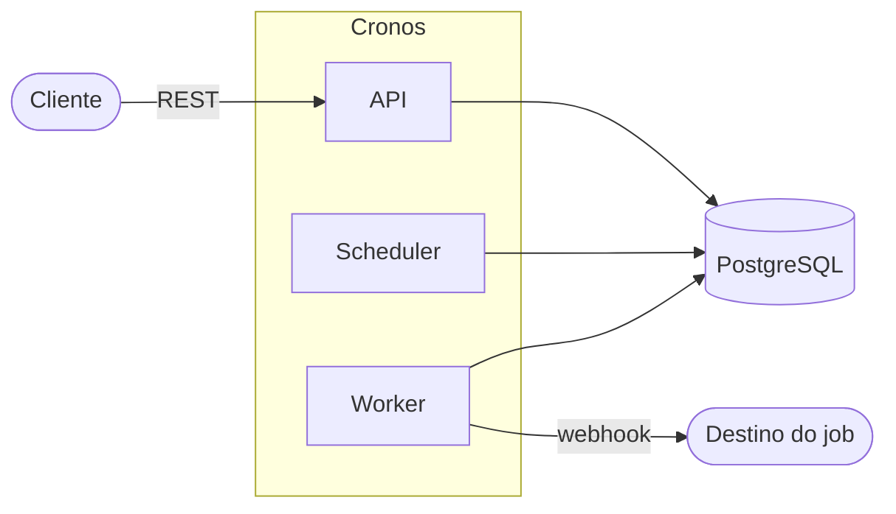
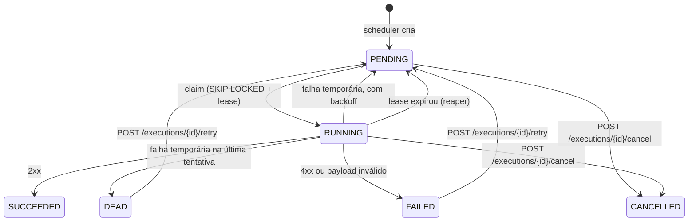

# Cronos

Agendador de jobs distribuído, escrito em Kotlin com Spring Boot e PostgreSQL.

Você cadastra jobs com um agendamento (cron, intervalo ou execução única) e o Cronos garante que cada ocorrência seja registrada **uma única vez**, mesmo com várias instâncias do scheduler rodando ao mesmo tempo e mesmo depois de o sistema ficar fora do ar.

> **Status:** todos os itens do [roadmap](#roadmap) estão prontos: scheduler, misfire, API, worker com lease/heartbeat/reaper, retentativas, timeout, cancelamento, disparo manual, métricas e testes de integração, caos e carga. O que falta para produção está em [Limitações conhecidas](#limitações-conhecidas).

## Sumário

- [Por que este projeto](#por-que-este-projeto)
- [Arquitetura](#arquitetura)
- [Como o scheduler funciona](#como-o-scheduler-funciona)
- [Política de misfire](#política-de-misfire)
- [Como o worker funciona](#como-o-worker-funciona)
- [Métricas](#métricas)
- [Stack](#stack)
- [Como rodar](#como-rodar)
- [API](#api)
- [Decisões de projeto](#decisões-de-projeto)
- [Estrutura do projeto](#estrutura-do-projeto)
- [Testes](#testes)
- [Desempenho](#desempenho)
- [Roadmap](#roadmap)
- [Limitações conhecidas](#limitações-conhecidas)

## Por que este projeto

O `CronJob` do Kubernetes e o `@Scheduled` do Spring resolvem o caso simples, mas deixam de fora o que dói em produção:

| Necessidade | `@Scheduled` | `CronJob` (K8s) | Cronos |
|---|---|---|---|
| Rodar uma vez só com várias réplicas | não (cada instância dispara) | sim | sim |
| Histórico de execuções consultável | não | limitado | sim (tabela `executions`) |
| Política para disparos perdidos | não | limitada | sim (`SKIP`, `FIRE_ONCE`, `FIRE_ALL`) |
| Pausar e retomar por API | não | editando o recurso | sim |
| Evitar sobreposição de execuções | não | `concurrencyPolicy` | sim (`allowOverlap`) |
| Fuso horário por job | não | por cluster | sim |

O objetivo é praticar problemas clássicos de sistemas distribuídos: coordenação sem lock central, deduplicação, recuperação de falhas e semântica de entrega.

## Arquitetura



Os três componentes não se comunicam diretamente. Toda a coordenação acontece pelo PostgreSQL:

- **API** cria, consulta, pausa e retoma jobs.
- **Scheduler** transforma jobs vencidos em linhas na tabela `executions`.
- **Worker** reivindica execuções pendentes e as realiza chamando o webhook do job.

Como não há comunicação entre processos, dá para subir várias réplicas de cada um sem configuração extra.

### Modelo de dados

- `jobs`: definição do job (agendamento, payload, política de misfire, status) e o campo `next_fire_at`, que é o que o scheduler consulta.
- `executions`: uma linha por ocorrência de um job, com status, tentativas e dados de lease. A restrição `UNIQUE (job_id, scheduled_for)` impede duplicidade.

## Como o scheduler funciona

A cada tick (padrão: 1 segundo), numa única transação:

1. Seleciona um lote de jobs `ACTIVE` com `next_fire_at <= now()` usando `FOR UPDATE SKIP LOCKED`. Cada instância pega um conjunto diferente de jobs, sem esperar uma pela outra.
2. Para cada job, o `MisfireResolver` decide quais ocorrências devem virar execução e qual será o próximo `next_fire_at`. Isso acontece em memória.
3. Insere todas as execuções do lote num único batch, com `ON CONFLICT DO NOTHING`. Se outra instância já criou a mesma ocorrência, o insert é ignorado.
4. Atualiza o `next_fire_at` de todos os jobs do lote, também em batch (ou marca o job como `COMPLETED` se não houver mais ocorrências).
5. Se o lote veio cheio, repete imediatamente sem esperar o próximo tick.

Duas barreiras contra duplicidade, em camadas: o `SKIP LOCKED` evita que duas instâncias processem o mesmo job ao mesmo tempo, e a restrição `UNIQUE` garante a unicidade mesmo se a primeira falhar.

Um job com agendamento inválido é pausado e registrado em log, em vez de travar o lote inteiro.

## Política de misfire

*Misfire* é um disparo que ficou atrasado além da tolerância do job (`misfireThresholdSeconds`, padrão 60). Isso acontece, por exemplo, quando o sistema ficou fora do ar. O que fazer com o tempo perdido é configurável por job.

Exemplo: job que roda a cada minuto, sistema parado das 10:00 às 10:05:30.

| Política | Comportamento | Resultado no exemplo |
|---|---|---|
| `SKIP` | Ignora o que foi perdido e segue na próxima ocorrência futura | nenhuma execução; próximo disparo às 10:06 |
| `FIRE_ONCE` (padrão) | Cria uma única execução de recuperação | 1 execução (10:00); próximo às 10:06 |
| `FIRE_ALL` | Recupera todas as ocorrências perdidas, com limite de 100 por rodada | 6 execuções (10:00 a 10:05); próximo às 10:06 |

Se o limite de 100 for atingido no `FIRE_ALL`, o `next_fire_at` aponta para a próxima ocorrência ainda perdida e o tick seguinte continua de onde parou.

## Como o worker funciona

O worker roda na mesma aplicação (pode ser desligado com `cronos.worker.enabled=false` para ter instâncias só de scheduler).



1. **Claim.** O worker reserva até o número de slots livres (`concurrency`, padrão 16) com um único `UPDATE ... WHERE id IN (SELECT ... FOR UPDATE SKIP LOCKED)`. A execução vira `RUNNING`, recebe `locked_by` (id do worker), `lease_expires_at` e `attempt + 1`. Só reserva o que consegue executar agora, para não segurar trabalho que outro worker poderia pegar. Enquanto a fila tiver trabalho, volta a reservar assim que um slot vaga; quando ela esvazia, espera o próximo poll (500 ms).
2. **Webhook.** Cada execução roda numa virtual thread. O payload do job define a chamada:
   ```json
   { "url": "https://...", "method": "POST", "headers": { "Authorization": "..." }, "body": { ... } }
   ```
   `method` é `POST` por padrão. O worker envia os headers `Idempotency-Key` (id da execução), `X-Cronos-Execution-Id`, `X-Cronos-Job-Id`, `X-Cronos-Attempt` e `X-Cronos-Scheduled-For`. O `timeoutSeconds` do job é o prazo total da chamada.
3. **Resultado.** Gravado só se a execução ainda for deste worker (`WHERE locked_by = ? AND status = 'RUNNING'`). Se o lease expirou e o reaper já a devolveu para a fila, o resultado atrasado é descartado.

| Resposta | Tipo | Destino |
|---|---|---|
| 2xx | sucesso | `SUCCEEDED` |
| 5xx, 408, 429, timeout, erro de conexão | temporária | `PENDING` com backoff; `DEAD` ao atingir `maxAttempts` |
| demais 4xx, payload sem `url` ou inválido | definitiva | `FAILED`, sem retentativa |

**Backoff** exponencial com *equal jitter*: `base * 2^(tentativa-1)`, limitado a `backoff-max`, e sorteado entre metade e o valor cheio. Com o padrão de 1 s: ~0,5–1 s, ~1–2 s, ~2–4 s... até 5 min.

**Heartbeat e reaper.** Enquanto há chamadas em andamento, o worker renova o lease a cada 10 s (lease de 30 s). Se ele morrer ou travar, o lease vence e o reaper (em qualquer instância, a cada 5 s) devolve a execução para `PENDING`, ou `DEAD` se ela já usou todas as tentativas.

**Cancelamento.** `POST /executions/{id}/cancel` marca a execução como `CANCELLED`. Se ela estiver `RUNNING`, o worker que a detém percebe em até 1 s (`cancel-check-interval-ms`) e aborta a chamada HTTP. O cancelamento aborta só a requisição, sem interromper a thread: um interrupt numa virtual thread fecharia a conexão JDBC se chegasse no meio da gravação do resultado. Uma chamada que já chegou ao destino pode ter produzido efeito lá.

**Disparo manual e retentativa.** `POST /jobs/{id}/trigger` cria uma execução agora (`triggeredBy = MANUAL`), em qualquer status do job, sem alterar o `next_fire_at`, e respeita `allowOverlap`. `POST /executions/{id}/retry` recoloca uma execução `DEAD` ou `FAILED` na fila com as tentativas zeradas e **o mesmo id**: é a mesma ocorrência, então a mesma chave de idempotência.

**Desligamento.** O worker para de reservar e espera até `shutdown-grace` (30 s) pelas chamadas em andamento. O que não terminar é recuperado pelo reaper.

**Semântica de entrega: at-least-once.** Se o worker morrer depois de chamar o webhook e antes de gravar o resultado, a execução roda de novo. O destino deve deduplicar pelo `Idempotency-Key`.

## Métricas

Expostas em `/actuator/prometheus`. Os nomes abaixo estão no formato do Micrometer; o Prometheus troca `.` por `_` e acrescenta sufixos como `_seconds` e `_total`.

| Métrica | Tipo | O que mede |
|---|---|---|
| `cronos.scheduler.lag` | timer (p50/p95/p99) | Atraso entre o `next_fire_at` e o momento em que o scheduler processou o job |
| `cronos.execution.start.delay` | timer (p50/p95/p99) | Atraso entre o horário lógico (`scheduled_for`) e o início da 1ª tentativa: o atraso de disparo visto pelo destino |
| `cronos.scheduler.executions.created` | contador | Execuções criadas pelo scheduler |
| `cronos.scheduler.executions.duplicate` | contador | Ocorrências que outra instância já tinha criado (barradas pelo `UNIQUE`) |
| `cronos.scheduler.misfires{policy}` | contador | Misfires por política |
| `cronos.scheduler.overlap.skipped` | contador | Ocorrências ignoradas por `allowOverlap = false` |
| `cronos.scheduler.jobs.invalid` | contador | Jobs pausados por agendamento inválido |
| `cronos.worker.executions{outcome}` | contador | Resultado de cada tentativa: `succeeded`, `retry`, `dead`, `failed`, `discarded`, `error` |
| `cronos.webhook.duration{result}` | timer | Duração das chamadas ao webhook, por `success`/`failure` |
| `cronos.worker.inflight` | gauge | Execuções em andamento nesta instância |
| `cronos.worker.reaped` | contador | Execuções recuperadas de workers que pararam de responder |

Taxa de falha, por exemplo: `sum(rate(cronos_worker_executions_total{outcome=~"retry|dead|failed"}[5m])) / sum(rate(cronos_worker_executions_total[5m]))`.

## Stack

- Kotlin e Java 21
- Spring Boot 4 (Web, JDBC, Validation, Actuator)
- PostgreSQL 16
- Flyway para migrations
- Micrometer + Prometheus para métricas
- JUnit 5 nos testes
- Docker Compose para o ambiente local

## Como rodar

### Pré-requisitos

- JDK 21
- Docker

### Passos

```bash
# 1. Subir o PostgreSQL
docker compose up -d

# 2. Rodar a aplicação (o Flyway cria as tabelas na primeira execução)
./gradlew bootRun        # no Windows: .\gradlew.bat bootRun
```

A API fica em `http://localhost:8080`. O scheduler começa a rodar junto com a aplicação.

Para zerar o banco: `docker compose down -v`.

### Configuração

`src/main/resources/application.yaml`:

| Propriedade | Padrão | Descrição |
|---|---|---|
| `cronos.scheduler.batch-size` | `100` | Máximo de jobs processados por transação |
| `cronos.scheduler.poll-interval-ms` | `1000` | Intervalo entre ticks do scheduler |
| `cronos.worker.enabled` | `true` | Liga o worker nesta instância |
| `cronos.worker.concurrency` | `16` | Execuções simultâneas por instância |
| `cronos.worker.poll-interval-ms` | `500` | Intervalo entre tentativas de claim |
| `cronos.worker.lease` | `30s` | Validade da reserva sem heartbeat |
| `cronos.worker.heartbeat-interval-ms` | `10000` | Intervalo de renovação do lease |
| `cronos.worker.cancel-check-interval-ms` | `1000` | Intervalo para perceber cancelamentos de execuções em andamento |
| `cronos.worker.reaper-interval-ms` | `5000` | Intervalo do reaper |
| `cronos.worker.backoff-base` | `1s` | Espera antes da 2ª tentativa |
| `cronos.worker.backoff-max` | `5m` | Teto do backoff |
| `cronos.worker.shutdown-grace` | `30s` | Espera pelas execuções em andamento ao desligar |

## API

O arquivo [`jobs.http`](jobs.http) tem exemplos prontos para o cliente HTTP do IntelliJ.

| Método | Rota | Descrição |
|---|---|---|
| `POST` | `/jobs` | Cria um job |
| `GET` | `/jobs?status=&page=&size=` | Lista jobs (tamanho máximo de página: 100) |
| `GET` | `/jobs/{id}` | Detalhe do job |
| `GET` | `/jobs/{id}/executions` | Histórico de execuções |
| `POST` | `/jobs/{id}/pause` | Pausa um job `ACTIVE` |
| `POST` | `/jobs/{id}/resume` | Retoma um job `PAUSED` |
| `POST` | `/jobs/{id}/trigger` | Dispara o job agora, fora do agendamento |
| `GET` | `/executions/{id}` | Detalhe de uma execução |
| `POST` | `/executions/{id}/cancel` | Cancela uma execução `PENDING` ou `RUNNING` |
| `POST` | `/executions/{id}/retry` | Recoloca na fila uma execução `DEAD` ou `FAILED` |
| `GET` | `/actuator/health` | Saúde da aplicação |
| `GET` | `/actuator/prometheus` | Métricas |

### Criar um job

```bash
curl -X POST http://localhost:8080/jobs \
  -H "Content-Type: application/json" \
  -d '{
    "name": "relatorio-horario",
    "scheduleType": "CRON",
    "scheduleExpr": "0 0 * * * *",
    "timezone": "America/Sao_Paulo",
    "misfirePolicy": "SKIP",
    "payload": { "url": "https://example.com/relatorio", "method": "POST" }
  }'
```

### Payload

| Campo | Obrigatório | Descrição |
|---|---|---|
| `url` | sim | URL `http` ou `https` chamada pelo worker |
| `method` | não | `GET`, `POST` (padrão), `PUT`, `PATCH` ou `DELETE` |
| `headers` | não | Objeto de strings, enviado como headers |
| `body` | não | Qualquer JSON, enviado como corpo com `Content-Type: application/json` |

O payload é validado na criação do job (`400` se inválido).

### Formatos de agendamento

| `scheduleType` | `scheduleExpr` | Exemplo |
|---|---|---|
| `CRON` | 6 campos, **com segundos** (formato do Spring) | `0 */5 * * * *` (a cada 5 minutos) |
| `INTERVAL` | Duração ISO-8601, mínimo de 1 segundo | `PT30S`, `PT5M`, `PT2H` |
| `ONCE` | Instante ISO-8601 no futuro | `2026-12-31T23:00:00Z` |

### Campos opcionais

| Campo | Padrão | Descrição |
|---|---|---|
| `timezone` | `UTC` | Fuso usado para avaliar o cron |
| `misfirePolicy` | `FIRE_ONCE` | `SKIP`, `FIRE_ONCE` ou `FIRE_ALL` |
| `misfireThresholdSeconds` | `60` | Tolerância antes de considerar misfire |
| `allowOverlap` | `false` | Permite nova execução com outra ainda ativa |
| `maxAttempts` | `3` | Tentativas máximas (1 a 20) antes de virar `DEAD` |
| `timeoutSeconds` | `60` | Prazo total de cada chamada ao webhook |

### Erros

As respostas de erro seguem o formato `ProblemDetail` (RFC 7807): `400` para agendamento, payload ou campos inválidos, `404` para job ou execução inexistente e `409` para transição de status inválida (por exemplo, pausar um job já pausado, cancelar uma execução já concluída ou disparar manualmente um job sem sobreposição que já tem execução ativa).

## Decisões de projeto

**PostgreSQL como fila, sem Redis nem Kafka.** `FOR UPDATE SKIP LOCKED` permite que vários consumidores disputem linhas sem bloqueio mútuo. Isso reduz a infraestrutura a um único componente e dá consistência transacional entre definição do job, execução e histórico. O custo é um teto de vazão menor que o de um broker dedicado, o que é aceitável para o volume esperado de um agendador.

**`scheduled_for` é o horário lógico, não o horário real do disparo.** A chave `UNIQUE (job_id, scheduled_for)` identifica "a ocorrência das 10:00 do job X", independentemente de quando ela foi criada. É isso que torna a deduplicação confiável mesmo com atrasos e reprocessamentos.

**A decisão de misfire é uma função pura.** O `MisfireResolver` recebe o job e o horário atual e devolve o que fazer, sem acessar banco nem relógio. Isso permite testar todas as políticas com testes unitários rápidos, sem containers.

**`resume` não recalcula `next_fire_at`.** Se o horário passou durante a pausa, a política de misfire do job decide o que fazer com o tempo perdido. O comportamento fica consistente entre "ficou parado por falha" e "ficou parado por pausa".

**`JdbcTemplate` em vez de JPA.** As consultas centrais (`SKIP LOCKED`, `ON CONFLICT`, updates condicionais) exigem SQL explícito, e o ORM atrapalharia mais do que ajudaria.

**Cron do Spring (`CronExpression`).** Já vem no framework, aceita segundos e é avaliado sobre `ZonedDateTime`, então fuso e horário de verão são tratados pelo `java.time`.

**Relógio injetado (`Clock`).** Facilita testes e deixa explícito de onde vem o "agora".

## Estrutura do projeto

```
cronos/
├── docker-compose.yaml
├── jobs.http
├── scripts/
│   ├── e2e-workers.mjs     # teste ponta a ponta com receptor de webhooks
│   ├── chaos.mjs           # mata instâncias aleatoriamente e verifica duplicidade e perda
│   └── load.mjs            # mede vazão e atraso de disparo
└── src/
    ├── main/
    │   ├── kotlin/io/github/juliofilizzola/cronos/
    │   │   ├── api/           # controllers, DTO de entrada, tratamento de erros
    │   │   ├── service/       # regras de negócio, validação de agendamento e de payload
    │   │   ├── persistence/   # repositórios com SQL explícito (jobs e executions)
    │   │   ├── scheduling/    # SchedulerLoop, MisfireResolver, NextFireCalculator
    │   │   ├── worker/        # Worker, WebhookClient, RetryPolicy, WorkerProperties
    │   │   ├── domain/        # Job, JobDetails, enums, exceções
    │   │   └── config/        # beans (Clock, calculadora, resolver, retry, cliente HTTP)
    │   └── resources/
    │       ├── application.yaml
    │       └── db/migration/  # V1__init, V2__misfire_and_completed, V3__manual_trigger_and_cancel
    └── test/kotlin/...        # testes unitários e de integração (Testcontainers)
```

## Testes

Com o Docker no ar (os testes de integração sobem um PostgreSQL 16 via Testcontainers, compartilhado por todas as classes):

```bash
./gradlew test
```

Os testes unitários não dependem de banco e podem rodar isolados:

```bash
./gradlew test --tests '*MisfireResolverTest' --tests '*RetryPolicyTest'
```

- `MisfireResolverTest`: disparo dentro da tolerância, cada uma das três políticas, o limite do `FIRE_ALL`, cron com a próxima ocorrência futura e job `ONCE` perdido.
- `RetryPolicyTest`: sucesso, retentativa, `DEAD` na última tentativa, falha definitiva, crescimento e teto do backoff e classificação dos status HTTP.

Testes de integração:

- `ConcurrencyIntegrationTest`: 8 threads disputando o claim de 300 execuções sem nenhuma reservada duas vezes; resultado de worker que perdeu a reserva descartado; reaper devolvendo para a fila ou marcando `DEAD`; heartbeat protegendo execução viva; 4 schedulers simultâneos recuperando 30 s perdidos de 20 jobs sem duplicar nem deixar buracos; transições de disparo manual, cancelamento e retentativa.
- `WorkerIntegrationTest`: worker real contra um servidor HTTP local: sucesso com `Idempotency-Key`, 500 retentado até `DEAD`, 404 sem retentativa, timeout, cancelamento interrompendo uma chamada em andamento e retentativa de `DEAD` com o mesmo id.

### Teste ponta a ponta

Com a aplicação rodando, o script [`scripts/e2e-workers.mjs`](scripts/e2e-workers.mjs) (Node 22, sem dependências) sobe um receptor de webhooks na porta 4000, cria sete jobs (sucesso, sem sobreposição, falha 500, webhook lento, disparo manual, cancelamento e `ONCE`), mostra cada transição de status e cada chamada recebida em tempo real e, no fim, roda 14 verificações: nada duplicado, entrega única, `Idempotency-Key`, sobreposição, retentativas, `DEAD`, timeout, disparo manual, cancelamento de execução em andamento, retentativa de `DEAD` via API e `ONCE`.

```bash
node scripts/e2e-workers.mjs
```

Variáveis: `CRONOS_URL` (padrão `http://localhost:8080`), `WEBHOOK_PORT` (`4000`), `WEBHOOK_HOST` (`localhost`; use `host.docker.internal` se o Cronos rodar em container) e `DURATION_S` (`30`). Sai com código 0 se tudo passar. Os jobs criados são pausados no final.

### Teste de caos

[`scripts/chaos.mjs`](scripts/chaos.mjs) sobe 3 instâncias do jar sobre o mesmo PostgreSQL, cria 20 jobs que disparam a cada segundo (`FIRE_ALL`, para que todo segundo perdido seja recuperado) e, durante 60 s, mata uma instância aleatória a cada 5 s com `SIGKILL` (sem desligamento limpo), reiniciando-a de 2 a 6 s depois. No fim, pausa os jobs, espera a fila esvaziar e verifica: nenhuma ocorrência duplicada, nenhum segundo faltando em nenhum job, nada preso em `PENDING`/`RUNNING`, tudo `SUCCEEDED` e toda execução entregue ao webhook.

```bash
./gradlew bootJar
node scripts/chaos.mjs
```

Resultado de uma execução: 12 mortes, 1438 execuções, 0 duplicadas, 0 perdidas, 24 execuções que precisaram de mais de uma tentativa (estavam em voo num worker morto) e 6 entregas repetidas ao webhook, o esperado com *at-least-once*. Variáveis: `INSTANCES`, `JOBS`, `DURATION_S`, `KILL_EVERY_S`, `DRAIN_S`, `BASE_PORT`, `WEBHOOK_PORT` e `JAVA`. Os logs das instâncias ficam em `build/chaos-logs/`.

## Desempenho

[`scripts/load.mjs`](scripts/load.mjs) cria N jobs disparando a cada segundo e mede, no receptor de webhooks, as execuções entregues por segundo e o atraso entre o horário lógico (`X-Cronos-Scheduled-For`) e a chegada da chamada. Cada degrau tem 10 s de aquecimento e 30 s de medição.

```bash
node scripts/load.mjs
```

Uma instância com a configuração padrão (`concurrency: 16`, pool de 10 conexões), PostgreSQL 16 no Docker Desktop, tudo na mesma máquina (AMD Ryzen 7 5700G, 16 threads, 24 GB, Windows 11):

| jobs | esperado/s | entregue/s | atraso p50 | atraso p95 | atraso p99 | atraso máx |
|---|---|---|---|---|---|---|
| 100 | 100 | 97 | 969 ms | 3100 ms | 3749 ms | 3956 ms |
| 250 | 250 | 251 | 878 ms | 1367 ms | 1448 ms | 1504 ms |
| 500 | 500 | 514 | 877 ms | 1439 ms | 1472 ms | 1485 ms |
| 1000 | 1000 | 1005 | 1157 ms | 1512 ms | 1560 ms | 1623 ms |
| 2000 | 2000 | 1268 | 10974 ms | 15323 ms | 15699 ms | 15790 ms |

Com `cronos.worker.concurrency=64` e `spring.datasource.hikari.maximum-pool-size=40`, a mesma instância entrega os 2000/s com atraso p50 de 967 ms e p99 de 1463 ms.

Como ler:

- **O atraso de ~1 s com pouca carga é o intervalo de polling**, não processamento: o scheduler roda a cada 1 s e o worker a cada 500 ms, então uma ocorrência espera em média ~0,5 s por cada um. Para disparos mais pontuais, reduza `cronos.scheduler.poll-interval-ms`. O p99 alto do primeiro degrau vem do aquecimento da JVM.
- **Até 1000 execuções/s por instância** com a configuração padrão. Acima disso, o gargalo é o worker (16 slots, cada execução faz uma escrita própria): no degrau de 2000, `cronos.scheduler.lag` ficou com p50 de 0,5 s e `cronos.execution.start.delay` com p50 de 10,7 s. Mais concorrência e conexões, ou mais instâncias, resolvem.
- **Agrupar as escritas do scheduler fez diferença.** Antes do batch, o scheduler fazia duas idas ao banco por job e entregava só 724/s com 1000 jobs (atraso p50 de 7,6 s).
- Os números são de uma máquina de desenvolvimento com banco, aplicação e gerador de carga juntos. Servem para comparar mudanças, não como capacidade de produção.

## Roadmap

- [x] Modelo de dados e migrations
- [x] Scheduler com `SKIP LOCKED` e deduplicação por `UNIQUE`
- [x] Política de misfire (`SKIP`, `FIRE_ONCE`, `FIRE_ALL`)
- [x] API de jobs (criar, consultar, listar, pausar, retomar) e histórico de execuções
- [x] Worker: claim de execuções com lease e execução de webhooks
- [x] Heartbeat e reaper para recuperar execuções de workers que morreram
- [x] Retentativas com backoff exponencial e jitter, e dead-letter (`DEAD`)
- [x] Timeout de execuções
- [x] Teste ponta a ponta com receptor de webhooks (`scripts/e2e-workers.mjs`)
- [x] Cancelamento de execuções em andamento
- [x] Endpoint de disparo manual e retentativa de execução `DEAD`
- [x] Validação do payload na criação do job
- [x] Métricas customizadas (atraso de disparo, taxa de falha, misfires)
- [x] Testes de integração com Testcontainers
- [x] Teste de caos: matar schedulers e workers aleatoriamente e verificar que nada duplica nem se perde
- [x] Teste de carga com números no README

## Limitações conhecidas

- **Sem autenticação** na API.
- **Jobs criados antes da validação de payload** podem ter payload inválido; cada execução deles termina em `FAILED`.
- **Sem DELETE de jobs nem limpeza do histórico:** a tabela `executions` cresce indefinidamente.
- **Cancelar não desfaz efeitos:** se a chamada já chegou ao destino, ele pode ter agido.
- **Sem proteção contra SSRF:** o worker chama qualquer URL `http`/`https` do payload, inclusive endereços internos.
- **Dependência de relógio:** o scheduler usa o relógio da JVM. Com instâncias com horários muito diferentes, os disparos podem variar levemente. Usar o `now()` do PostgreSQL é uma alternativa avaliada.
- **Garantia de entrega:** *at-least-once*, o que exige idempotência do lado de quem recebe. O `id` da execução vai no header `Idempotency-Key`.

## Autor

[@juliofilizzola](https://github.com/juliofilizzola)